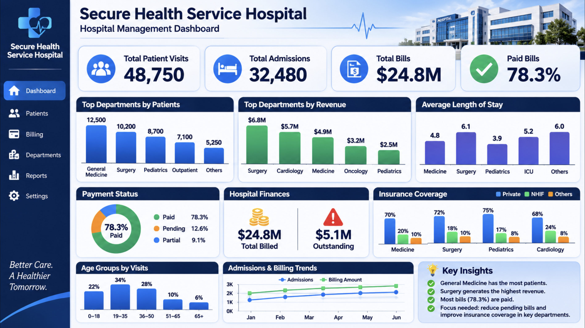

# THE SECURE HEALTH SERVICE HOSPITAL MANAGEMENT SYSTEM 
The management of a Secure Life General Hospital has observed a change in patient admissions,
outstanding medical bills, and variations in insurance coverage across its departments. The hospital wants to
use patient admission, billing and insurance data to understand its operational performance, monitor
payments and improve management decision-making. However, the hospital currently lacks a consolidated
report that provides a clear picture of its operational and financial performance.

## INTRODUCTION 

## ABOUT COURSE

*Support Course Companion source*: You can definitely find the support course companion -> [Open the Link Here!](https://www.kaggle.com/datasets/shree0910/ai-and-data-science-job-market-dataset-20202026)

## WHY PYTHON AND BRIEF HISTORY

1. **Python is characterized by many features.**
 

### History of Python

